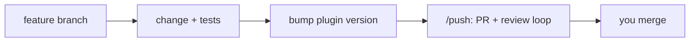

# Contributing

## Prerequisites

- `python3` 3.9+ (stdlib only) and `git`.
- `claude` (Claude Code), to install the plugin from your clone.
- `gh`, to ship changes with `/push`.
- `uvx`, for the dead-code and lint checks below.

`make check` lists what is missing.

## Set up

```bash
git clone https://github.com/cypiswhywhy/codechemy && cd codechemy
make install-plugin
```

`make install-plugin` points the `codechemy` marketplace at your clone and installs the plugin
from it, so the hooks run from your working tree. `make uninstall-plugin` undoes it. Restart
Claude Code after either. A marketplace name holds one source, so if you installed from GitHub first, run
`claude plugin marketplace remove codechemy` before switching to your clone.
<!-- TODO: verify — the Makefile says re-adding an existing name just repoints it. --> Details: [docs/reference/make-targets.md](docs/reference/make-targets.md).

## Run tests and checks

```bash
pytest                                       # tests
uvx vulture . --min-confidence 80            # dead code
uvx ruff check --select F401,F841,ARG .      # unused imports, variables, arguments
```

No CI runs these; run them before you push. The tests build throwaway git repositories and
config dirs, and drive each hook the way Claude Code does (JSON on stdin).

## Project layout

Everything that ships is in `claude-code/plugins/engineering-practices/`: `practices/` (the
contract), `hooks/` (the scripts that print and check it) and `skills/`. The marketplace that
lists it is `.claude-plugin/marketplace.json`. `github-copilot/` holds the Copilot review
templates. How the parts fit: [docs/internals/architecture.md](docs/internals/architecture.md).

## Making a change



- Branch from `main`; never commit to it directly.
- Commit messages follow Conventional Commits: `feat(scope): …`, `fix(…)`, `refactor(…)`,
  `chore(…)`. Review fixes are `address code review (cycle N/3): …`.
- Bump `version` in `claude-code/plugins/engineering-practices/.claude-plugin/plugin.json` in
  the same change. Installs update only when it goes up.
- Ship with `/push`: it opens the PR and runs the automated review. Merging is manual.

### Adding a practice, hook or skill

- **Practice**: add `practices/NN-<topic>.md` with a single `#` heading. Keep it to rules the
  agent can check itself against, each with its reason in one clause. The SessionStart hook
  picks it up by name order.
- **Hook**: add the script to `hooks/` (stdlib only, log under `~/.claude/<name>/`), register it
  in `hooks/hooks.json` with `${CLAUDE_PLUGIN_ROOT}` in the command, and add a `test_*.py`.
- **Skill**: add `skills/<name>/SKILL.md` with `name` equal to the directory, and list it in
  [docs/reference/skills.md](docs/reference/skills.md).

## Design decisions

A change that alters how the plugin works, not just what it says, gets an ADR (architecture
decision record): [docs/internals/adrs/](docs/internals/adrs/README.md).

## Documentation

Update the docs in the same change. Start at [docs/README.md](docs/README.md).
