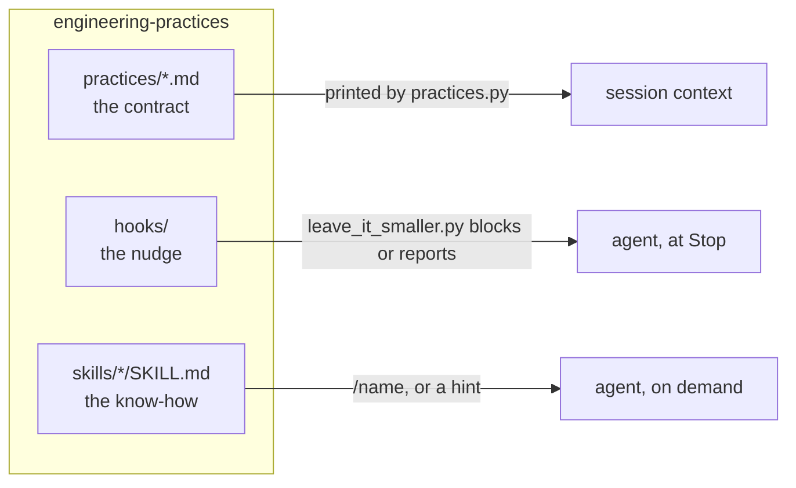

# Architecture

The plugin targets seven habits of coding agents: they start writing before they have
understood what is wanted; they add lines and rarely remove them, and turn a plan into one
thousand-line PR or into several PRs none of which is useful on its own; they write a
near-copy of a helper instead of generalising the one that exists; they leave errors swallowed
and input unchecked for the review to find; they document every line they write; they write the
code first and the tests, if at all, afterwards; and they bury the answer to the user under
preamble, recap and jargon.

The plugin combines three kinds of resource into one behaviour. All of it lives in
`claude-code/plugins/engineering-practices/`.



| Directory | Loaded as | Role |
|---|---|---|
| `practices/*.md` | printed by a `SessionStart` hook, in name order | **the contract**: what the agent should do and why |
| `hooks/` | `hooks.json`, registered per event | **the nudge**: deterministic checks the agent cannot forget |
| `skills/<name>/` | `/<name>` in any session | **the know-how**: procedures the agent runs when asked or hinted |

The marketplace that lists the plugin is `.claude-plugin/marketplace.json` at the repository
root; the plugin's own manifest is `.claude-plugin/plugin.json` inside its directory.

## A session, end to end

```mermaid
sequenceDiagram
    participant CC as Claude Code
    participant PR as practices.py
    participant LS as leave_it_smaller.py
    participant A as agent
    CC->>PR: SessionStart (JSON payload on stdin)
    PR-->>CC: practices text, unless the project opts out
    CC->>LS: SessionStart: session-start
    LS-->>CC: records the tree's starting shape; toolbox hint
    A->>CC: works, then tries to stop
    CC->>LS: Stop: stop
    alt a check fails and the session has nudges left
        LS-->>CC: decision: block, with the reason
        CC->>A: reason, so it continues
    else
        LS-->>CC: one-line systemMessage with the diff shape
    end
```

The per-session state (starting fingerprint, which checks have fired, how many blocks) is a
JSON file under `~/.claude/leave-it-smaller/sessions/`, pruned after seven days. What the Stop
hook checks, and its settings: [../reference/hooks.md](../reference/hooks.md).

## Why it is built this way

- **Why a plugin, and why the contract is a hook.** See
  [ADR 0001](adrs/0001-ship-as-a-plugin-with-the-contract-in-a-hook.md).
- **Why all three layers.** A rule alone is forgotten by turn 40; a hook alone can measure but
  not explain; a skill alone is never invoked. The contract says what, the `leave-it-smaller`
  hook keeps it visible late in a session, the skills make the expensive part (proving a
  deletion, splitting a plan) cheap enough to happen.
- **Why the hook blocks instead of only reporting.** A `systemMessage` is seen by the user; a
  `decision: block` with a `reason` is seen by the agent and acted on before it hands back.
- **Why it is bounded.** An unbounded nudge becomes noise the agent learns to justify away.
- **Why thresholds, and why new files count.** Zero removals in a 15-line addition is normal;
  in a 200-line change it is the smell this exists to catch - and a new module is exactly where
  a duplicated helper or a superseded path hides, so it is measured like any other file. Defaults are conservative and env-tunable.
- **Stdlib only, and never fatal.** Nothing to install beyond `python3`, and a bug in a hook
  never blocks a stop or fails a session.
