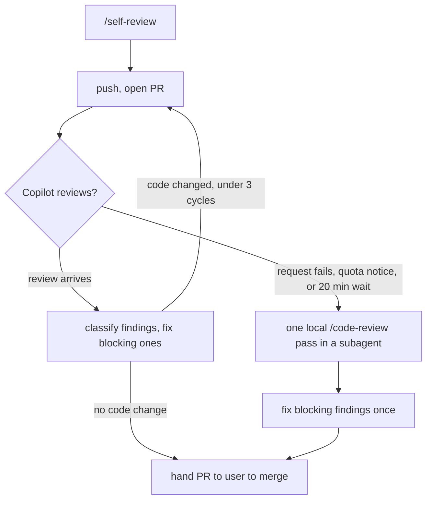

# Skills

Eight skills ship with the plugin; run each as `/<name>` in any session. Each links to its
`SKILL.md`, which is the full procedure.

| Skill | What it does |
|---|---|
| [`/frame`](../../claude-code/plugins/engineering-practices/skills/frame/SKILL.md) | One screen of design brief and plan - problem, what was assumed, invariant, constraints cited from the repo, the approach chosen and one rejected with its reason, blast radius, then the landing points with the test that proves each and how it can fail - then straight into the code, asking first only when the user can answer and the answer changes the plan. Says up front whether it frames at all. Refuses when the change is small enough to just write, and defers to `/opsx:propose` where the repo uses OpenSpec |
| [`/self-review`](../../claude-code/plugins/engineering-practices/skills/self-review/SKILL.md) | The mechanical pass over your own diff before anyone else reads it: symbols that do not exist, anchors that drifted, absolutes with a counterexample, claims the code cannot observe, duplication you just added, error paths, tests asserting a proxy |
| [`/push`](../../claude-code/plugins/engineering-practices/skills/push/SKILL.md) | Branch to merge-ready PR: self-review, push, PR, then the automated review loop until green, capped at three cycles counted from the branch - Copilot, or one pass of `/code-review` in a fresh-context subagent when Copilot is unavailable |
| [`/codebase-maintenance`](../../claude-code/plugins/engineering-practices/skills/codebase-maintenance/SKILL.md) | Audits a repo across 11 quality dimensions and lands the fixes as small, verified commits, through to a merge-ready PR |
| [`/maintenance-toolbox`](../../claude-code/plugins/engineering-practices/skills/maintenance-toolbox/SKILL.md) | Records a project's dead-code, unused-dependency, lint and test commands in its CLAUDE.md, so deletions can be proven |
| [`/claude-customizations`](../../claude-code/plugins/engineering-practices/skills/claude-customizations/SKILL.md) | Read-only audit of every Claude Code customization, CLI and Desktop, against a fresh install |
| [`/apply-increment`](../../claude-code/plugins/engineering-practices/skills/apply-increment/SKILL.md) | Implements one OpenSpec task group as its own PR, then stops |
| [`/apply-all-increments`](../../claude-code/plugins/engineering-practices/skills/apply-all-increments/SKILL.md) | Walks a change to main one increment per session, archiving the change at the end |

What each skill needs installed: [../usage/install.md](../usage/install.md#prerequisites).

## `/push` review loop

## `/maintenance-toolbox` in detail

Deletion needs global knowledge the agent lacks: which command lists dead code, unused
dependencies, unused imports, and runs the tests. The skill detects the stack, finds what is
configured (or proposes `vulture`/`deptry`/`ruff`, `knip`, `staticcheck`, `cargo machete`, ...),
asks the user one question about adding what is missing, verifies each command runs, and
writes a five-line `## Maintenance toolbox` section to the project's `CLAUDE.md`, where the
contract tells the agent to look before deleting. Declining writes
`<!-- maintenance-toolbox: none -->` so the hint stops. It records; `/codebase-maintenance` fixes.

## Related, outside this repository

[docschemy](https://github.com/cypiswhywhy/docschemy) — skills that generate and maintain
project documentation.
