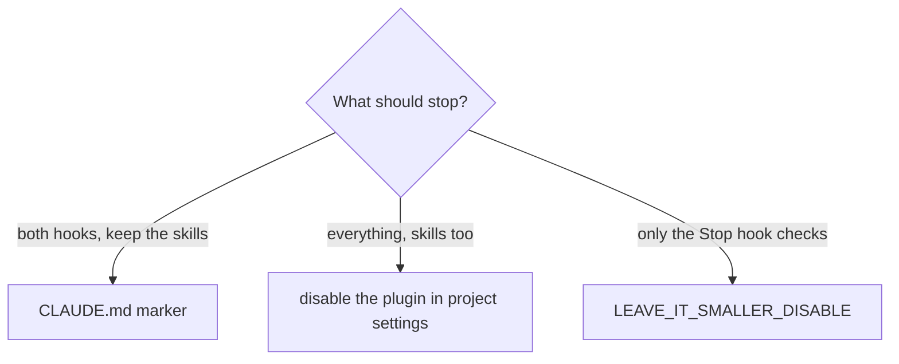

# Turn the plugin off for one project

The practices are about code. For a project that is not code — notes, a task system,
research — turn them off there.



## Both hooks: the CLAUDE.md marker

Add this line to the project's `CLAUDE.md` or `.claude/CLAUDE.md`:

```markdown
<!-- engineering-practices: off -->
```

New sessions there start without the contract, and the Stop hook stays silent. The skills
remain available. The file is read from the git repository root, or from the session's
directory outside a repository.

## Everything: disable the plugin

In the project's `.claude/settings.json` (shared) or `.claude/settings.local.json` (just you):

```json
{"enabledPlugins": {"engineering-practices@codechemy": false}}
```

## Only the Stop hook checks

Keep the contract, silence the checks at the end of a turn:

```json
{"env": {"LEAVE_IT_SMALLER_DISABLE": "1"}}
```

Other settings that tune the checks: [../reference/hooks.md](../reference/hooks.md).
